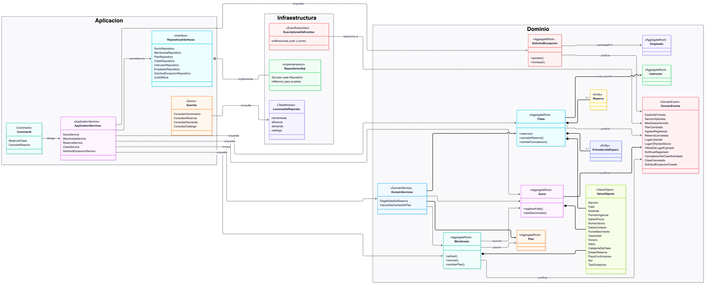
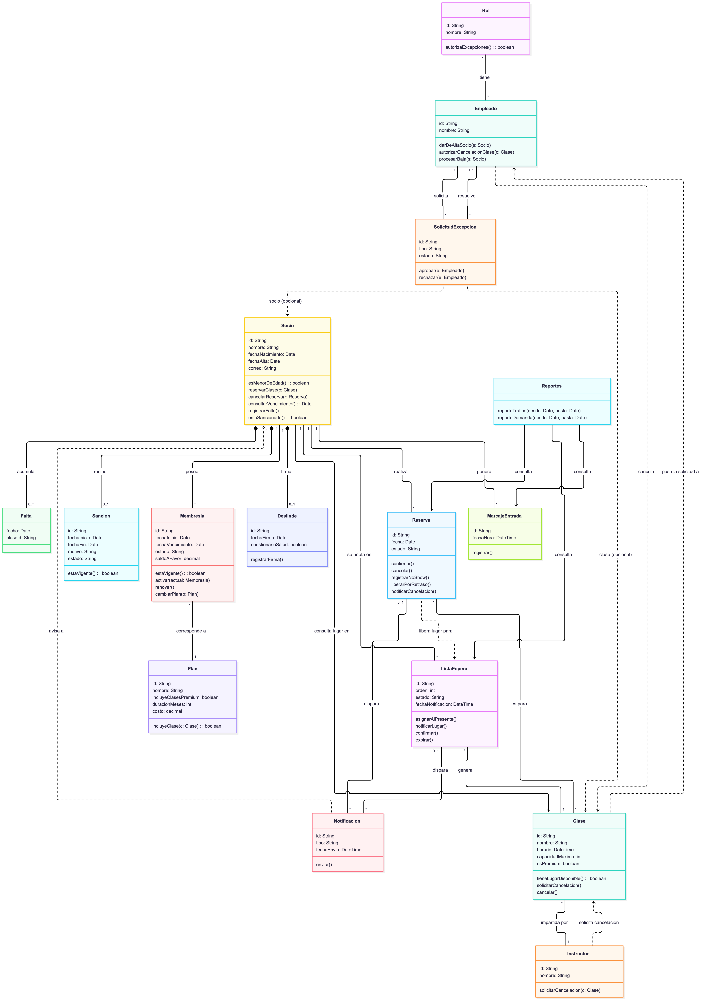

# fitzone-arquitectura

# FitZone: Diseño arquitectural del sistema

Actividad 3, Unidad 3 · Componentes de Lógica de Negocio · FIME UANL · Equipo 11

Repositorio: `fitzone-arquitectura`

## Descripción

Diseño de la arquitectura interna del sistema de gestión de FitZone a partir del levantamiento de requerimientos de la actividad anterior (BRD, user stories, BPMN y glosario). Se aplican Domain-Driven Design, Service Layer, Repository, Unit of Work y CQRS básico, y se revisa la propuesta con los principios SOLID.

## Integrantes

| Nombre | Matrícula |
|---|---|
| Josue Rodrigo Silva Fraga | 2153436 |
| Jesús Emmanuel Camacho Moreno | 2153842 |
| Valentín Monsivais Martínez | 2157656 |

**Profesor:** Miguel Ángel Gómez Marroquín

## Estructura del repositorio

```
fitzone-arquitectura/
├── README.md
├── ADRs/
│   └── ACT3_FZ_Equipo11_ADRs.pdf
└── DIAGRAMAS/
    ├── CLASES/
    │   ├── FitZone_Diagrama_Clases.mmd
    │   └── FitZone_Diagrama_Clases.png
    ├── DDD/
    │   ├── FitZone_Diagrama_Clases_DDD.mmd
    │   └── FitZone_Diagrama_Clases_DDD.png
    └── FLUJOS DE SECUENCIAS/
        ├── FLUJO_1/
        │   ├── FitZone_Secuencia_Flujo1_Reservar_Clase.mmd
        │   └── FitZone_Secuencia_Flujo1_Reservar_Clase.png
        └── FLUJO_2/
            ├── FitZone_Secuencia_Flujo2_Cancelacion_Clase.mmd
            └── FitZone_Secuencia_Flujo2_Cancelacion_Clase.png
```

## Entregables

| Entregable | Archivo o carpeta | Descripción |
|---|---|---|
| Diagrama de clases DDD | [`DIAGRAMAS/DDD`](DIAGRAMAS/DDD) | Aggregates, entidades, Value Objects, Domain Services y Domain Events, organizados en las capas de Dominio, Aplicación e Infraestructura |
| Diagrama de clases | [`DIAGRAMAS/CLASES`](DIAGRAMAS/CLASES) | Clases con sus atributos, métodos y relaciones |
| Diagrama de secuencia 1 | [`DIAGRAMAS/FLUJOS DE SECUENCIAS/FLUJO_1`](DIAGRAMAS/FLUJOS%20DE%20SECUENCIAS/FLUJO_1) | Reservar una clase y manejo de la lista de espera |
| Diagrama de secuencia 2 | [`DIAGRAMAS/FLUJOS DE SECUENCIAS/FLUJO_2`](DIAGRAMAS/FLUJOS%20DE%20SECUENCIAS/FLUJO_2) | Cancelación de una clase por el instructor |
| ADR | [`ADRs/ACT3_FZ_Equipo11_ADRs.pdf`](ADRs/ACT3_FZ_Equipo11_ADRs.pdf) | Registros de las decisiones arquitectónicas (documento PDF) |

## Decisiones principales

- **Patrón de lógica de negocio:** Domain Model como patrón principal, con Table Module solo para los reportes de tráfico y demanda.
- **Lista de espera y reservas:** viven dentro del Aggregate Clase, para proteger la capacidad y el orden FIFO.
- **Sanciones por no-show:** son automáticas y las aplica el Socio al registrar la tercera falta del mes.
- **Membresías:** cada socio tiene una sola membresía activa, y los planes son mensual, trimestral y anual.
- **Lugar liberado:** si es por cancelación, se ofrece con 15 minutos para confirmar; si es por retraso de más de 10 minutos, se asigna de inmediato al primero presente en la lista.

## Vista previa de los diagramas

### Diagrama de clases DDD



### Diagrama de clases



### Secuencia 1: reservar una clase


### Secuencia 2: cancelación de una clase


## Cómo ver los archivos fuente

Los archivos `.mmd` están escritos en [Mermaid](https://mermaid.js.org/). Para verlos o editarlos, abre [mermaid.live](https://mermaid.live) y pega el contenido del archivo. Cada diagrama incluye también su imagen `.png`.

## Uso de inteligencia artificial

Se utilizó inteligencia artificial como apoyo para generar borradores, proponer alternativas y revisar la consistencia del diseño. Todo el contenido fue revisado y validado por el equipo. La bitácora con las solicitudes y decisiones está en el reporte FIME.
